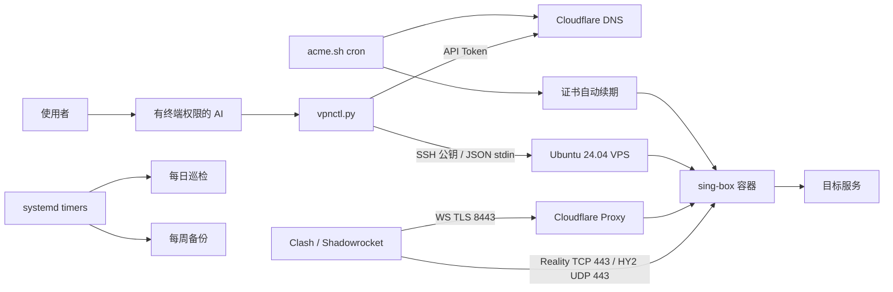

# 架构与边界

控制端只需 Python 标准库和 SSH。服务端执行器经 SSH 加密通道接收 JSON；Token 不出现在进程命令行。随机节点参数在 VPS 上生成，客户端导出不包含 Reality 私钥。

sing-box 镜像先拉取指定 tag，再把其官方仓库 digest 写入 Compose。默认不发布 IPv6 入口；客户端 IPv6 关闭。容器使用只读根文件系统、只读挂载、capability 收紧和日志轮转。

公开仓库只包含通用模板和测试数据。实际资源参数、客户端文件、ACME 账户、备份属于用户私有数据。

DNS 冲突策略：只创建缺失记录；同名 A 记录且地址/代理状态完全匹配时保留。任何不同 A、AAAA 或 CNAME 都拒绝覆盖。两条记录都检查后才写入；如果第二条创建网络失败，第一条可能已创建，重试会保留匹配记录。

受管目录、固定容器名、Compose project 标记用于隔离。已有 `/opt/sing-box` 或端口冲突阻止新部署。首版不提供旧部署接管、节点凭据轮换、域名迁移、多用户配额或自动异地恢复。

“服务端就绪”“客户端三线路可用”“用户设备 DNS 已接管”是三种不同证据。维护系统不会将它们混为一个成功状态。
